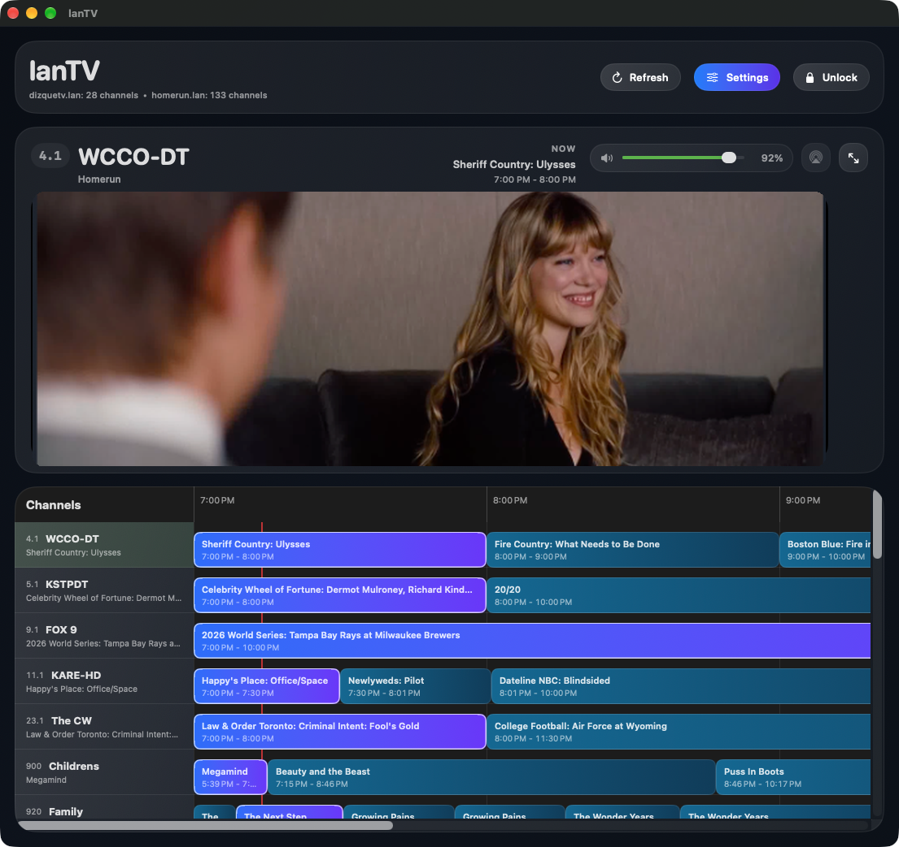

# lanTV

lanTV is a native macOS application designed for streaming live television, navigating Electronic Programme Guides (EPG), and aggregating SiliconDust HDHomeRun tuners and XMLTV feeds across your local area network.

Built with SwiftUI, AVKit, and VLCKit, lanTV combines an interactive TV grid, flexible live stream playback (HLS and MPEG-TS), detachable picture-in-picture windowing, Touch ID channel protection, and an integrated local IPTV server.



---

## Key Features

- **Electronic Programme Guide (EPG)**: Interactive grid timeline displaying currently airing and upcoming programs across all your channels with automatic time scrolling.
- **Multiple Source Aggregation**:
  - **XMLTV**: Connect any XMLTV guide URL with customizable stream URL templates (e.g., `http://server:8000/stream/{channel}`).
  - **HDHomeRun**: Automatic discovery of channel lineups and direct playback from SiliconDust network tuners.
- **Dual Playback Engine**:
  - Native **AVKit** for HLS (`.m3u8`) and progressive video streams.
  - Built-in **VLCKit** for broadcast MPEG-TS streams and raw tuner channels.
  - Direct AirPlay output support.
- **Detachable Floating Player**: Pop the video player out into a standalone floating window that stays on top while you use other apps.
- **Touch ID Channel Protection**: Lock sensitive or adult channels behind Touch ID or system passcode authentication.
- **Built-in Local IPTV API**: Acts as an IPTV proxy and aggregator for other media devices on your network (Apple TV, VLC, Kodi):
  - `/api/playlist.m3u`: Unified M3U playlist of all enabled channels.
  - `/api/guide.xmltv`: Unified XMLTV guide XML.
  - `/api/channels.json`: JSON channel list with current program metadata.
  - `/api/state.json`: Current playback state, volume, and source status.
- **External Guide Plugins**: Extend schedule fetching for specific channels using lightweight external scrapers written in Python or any language.

---

## Prerequisites

- **macOS**: 14.0 (Sonoma) or newer
- **Xcode**: 15.0 or newer (or Xcode Command Line Tools)
- **Architecture**: Apple Silicon (arm64) and Intel (x86_64)
- **Python 3**: (Optional) required only if you run custom Python guide plugins

---

## Setup & Build Walkthrough

### 1. Clone the Repository

```sh
git clone https://github.com/johndolljr/lanTV.git
cd lantv
```

### 2. Fetch Dependencies
lanTV uses [VLCKit](https://code.videolan.org/videolan/VLCKit) for broadcast MPEG-TS playback. Run the setup script to download the official VideoLAN binary framework:

```sh
./scripts/setup-dependencies.sh
```
*(Note: `./scripts/build.sh` will also run this automatically if the framework is missing).*

### 3. Build the Application
You can compile either a Debug or Release build:

```sh
# Debug configuration
./scripts/build.sh debug

# Release configuration
./scripts/build.sh release
```

### 4. Install for Daily Use
To install lanTV into your user Applications folder (`~/Applications/lanTV.app`):

```sh
./scripts/install.sh release
```

Or run directly from the terminal:

```sh
./scripts/run.sh
```

---

## App Transport Security (ATS) & Local Networks

Apple's App Transport Security (ATS) restricts plain HTTP loads for custom top-level domains (such as `.lan`, `.home`, or `.internal`) unless explicitly listed in `NSExceptionDomains`.

To keep the open-source repository completely clean and free of hardcoded personal hostnames, the build script (`scripts/build-app.sh`) handles ATS dynamically at build time:
1. **Automatic Detection**: Reads hostnames from your local `settings.json` if configured.
2. **Local Config**: Reads domains from a local `.local-domains` file (ignored by Git).
3. **Environment Override**: Reads `ATS_DOMAINS="host1.lan host2.lan"`.

The build script automatically injects these exception domains directly into the built app bundle's `Info.plist` and re-signs the application locally, ensuring smooth network streaming on your home network without committing private hostnames.

---

## Configuration & First Launch

All settings are managed graphically within the application. Open **Settings** (slider icon in the top bar or via the menu bar icon):

### Adding Sources
1. Go to **Settings** -> **Guide Sources**.
2. Click **Add XMLTV** or **Add HDHomeRun**:
   - **XMLTV**: Provide the guide URL (e.g., `http://192.168.1.10:8000/api/xmltv.xml`) and the stream template (e.g., `http://192.168.1.10:8000/video?channel={channel}`).
   - **HDHomeRun**: Enter your tuner's address (e.g., `http://hdhomerun.local/` or your tuner's local IP).
3. Click **Save Changes** and click **Refresh** on the top bar.

### Managing Channels
- **Hide Channels**: Uncheck any channel you do not watch. Hidden channels are excluded from both the guide grid and the exported M3U playlist.
- **Lock Channels**: Click the lock icon on sensitive channels. When locked, their names and listings are obscured until you click **Unlock** and authenticate with Touch ID.

### Local API Server
lanTV hosts a local HTTP server (default port `48921`, configurable in Settings). You can use this URL on other devices in your home:
- M3U Playlist: `http://<your-mac-ip>:48921/api/playlist.m3u`
- XMLTV Guide: `http://<your-mac-ip>:48921/api/guide.xmltv`

---

## Guide Plugins

When an XMLTV feed lacks detailed descriptions for specific channels, external guide plugins can supply listings on a custom schedule.

Plugins are stored in the `Plugins/` directory and use standard JSON over `stdin`/`stdout`. See [`Plugins/README.md`](Plugins/README.md) for documentation on creating custom plugins.

---

## Architecture Overview

- **`Sources/lanTV/Models/`**: Guide channels, programs, sources, and settings models.
- **`Sources/lanTV/Services/`**: Source loading (`GuideRepository`), XMLTV parsing, local cache storage, and `LocalAPIServer`.
- **`Sources/lanTV/ViewModels/`**: `GuideViewModel` managing player coordination, Touch ID authorization, and EPG timelines.
- **`Sources/lanTV/Views/`**: SwiftUI interface components, EPG grid renderer, volume controls, and floating player windows.
- **`Sources/lanTV/Plugins/`**: Process runner for external scrapers.

---

## License

This project is open-source under the [MIT License](LICENSE).
