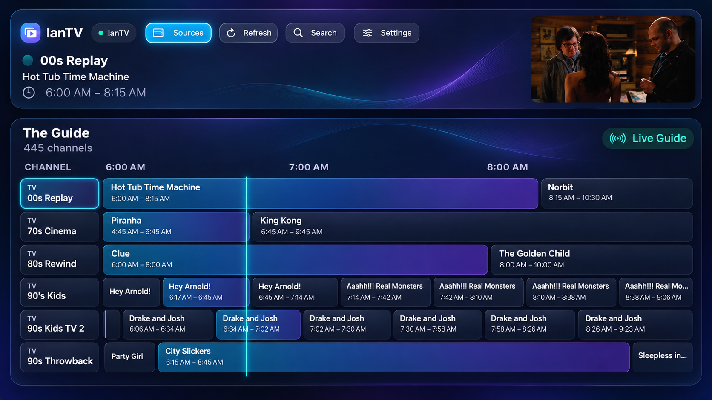
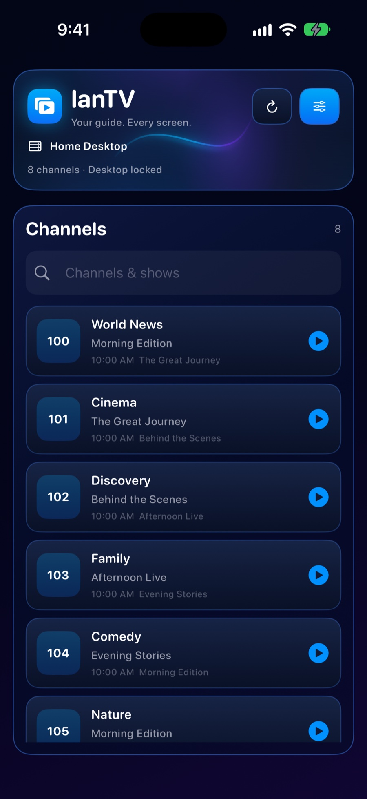
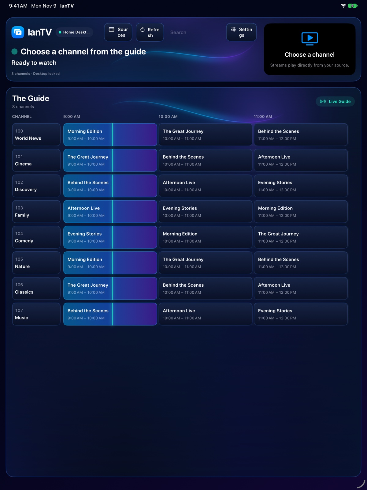

# lanTV

lanTV is a native TV guide and streaming app for macOS, iPhone, iPad, and Apple TV. It brings XMLTV and HDHomeRun lineups together, and lets each device play streams directly from their source.

The Mac app can also serve a unified guide and per-channel stream URLs to your mobile and TV apps over your local network. Channel locks stay synchronized with the desktop.



## Supported Devices

| Device | Experience |
| --- | --- |
| **Mac** | Full guide and source management, channel protection, recordings, and the local guide server. |
| **iPhone** | Search and browse channels, stream directly from sources, and keep a cached guide available when the Mac is offline. |
| **iPad** | A wide-screen guide close to the Apple TV layout in landscape, with a more compact guide and player layout in portrait. |
| **Apple TV** | Remote-first guide browsing, selected-channel preview, and quick full-screen playback with programme information and playback controls. |

The wide-screen image above is a visual preview of the shared Mac, iPad landscape, and Apple TV guide design. The mobile screenshots below use the app's privacy-safe demo guide.





---

## Key Features

- **Electronic Programme Guide (EPG)**: Interactive grid timeline displaying currently airing and upcoming programs across all your channels with automatic time scrolling.
- **Multiple Source Aggregation**:
  - **XMLTV**: Connect any XMLTV guide URL with customizable stream URL templates (e.g., `http://server:8000/stream/{channel}`).
  - **HDHomeRun**: Automatic discovery of channel lineups and direct playback from SiliconDust network tuners.
- **Dual Playback Engine**:
  - Native **AVKit** for HLS (`.m3u8`) and progressive video streams.
  - Built-in **VLCKit** for broadcast MPEG-TS streams and raw tuner channels.
  - Direct AirPlay output support.
- **Detachable Floating Player**: Pop the video player out into a standalone floating window that stays on top while you use other apps.
- **Touch ID Channel Protection**: Lock sensitive or adult channels behind Touch ID or system passcode authentication.
- **Built-in Local IPTV API**: Acts as an IPTV proxy and aggregator for other media devices on your network (Apple TV, VLC, Kodi):
  - `/api/playlist.m3u`: Unified M3U playlist of all enabled channels.
  - `/api/guide.xmltv`: Unified XMLTV guide XML.
  - `/api/channels.json`: JSON channel list with current program metadata.
  - `/api/state.json`: Current playback state, volume, and source status.
- **External Guide Plugins**: Extend schedule fetching for specific channels using lightweight external scrapers written in Python or any language.

---

## Prerequisites

- **macOS**: 14.0 (Sonoma) or newer
- **Xcode**: 15.0 or newer (or Xcode Command Line Tools)
- **Architecture**: Apple Silicon (arm64) and Intel (x86_64)
- **Python 3**: (Optional) required only if you run custom Python guide plugins

---

## Setup & Build Walkthrough

### 1. Clone the Repository

```sh
git clone https://github.com/johndolljr/lanTV.git
cd lantv
```

### 2. Fetch Dependencies
lanTV uses [VLCKit](https://code.videolan.org/videolan/VLCKit) for broadcast MPEG-TS playback. Run the setup script to download the official VideoLAN binary framework:

```sh
./scripts/setup-dependencies.sh
```
*(Note: `./scripts/build.sh` will also run this automatically if the framework is missing).*

### 3. Build the Application
You can compile either a Debug or Release build:

```sh
# Debug configuration
./scripts/build.sh debug

# Release configuration
./scripts/build.sh release
```

### 4. Install for Daily Use
To install lanTV into your user Applications folder (`~/Applications/lanTV.app`):

```sh
./scripts/install.sh release
```

Or run directly from the terminal:

```sh
./scripts/run.sh
```

---

## App Transport Security (ATS) & Local Networks

lanTV accepts user-configured HTTP guide and stream URLs, including arbitrary
`.lan`, `.home`, and `.internal` hostnames. Both apps use an ATS exception for
those arbitrary sources. No per-host build-time list is needed. Local-network
permission, working DNS, and a reachable upstream server are still required.

---

## Configuration & First Launch

All settings are managed graphically within the application. Open **Settings** (slider icon in the top bar or via the menu bar icon):

### Adding Sources
1. Go to **Settings** -> **Guide Sources**.
2. Click **Add XMLTV** or **Add HDHomeRun**:
   - **XMLTV**: Provide the guide URL (e.g., `http://192.168.1.10:8000/api/xmltv.xml`) and the stream template (e.g., `http://192.168.1.10:8000/video?channel={channel}`).
   - **HDHomeRun**: Enter your tuner's address (e.g., `http://hdhomerun.local/` or your tuner's local IP).
3. Click **Save Changes** and click **Refresh** on the top bar.

### Managing Channels
- **Hide Channels**: Expand **Channel Rules** for a source (collapsed by default), then check **Hidden** for any channel you do not watch. Hidden channels are excluded from both the guide grid and the exported M3U playlist.
- **Lock Channels**: Click the lock icon on sensitive channels. When locked, their names and listings are obscured until you click **Unlock** and authenticate with Touch ID.

### Local API Server
lanTV hosts a local HTTP server (default port `48921`, configurable in Settings). You can use this URL on other devices in your home:
- M3U Playlist: `http://<your-mac-ip>:48921/api/playlist.m3u`
- XMLTV Guide: `http://<your-mac-ip>:48921/api/guide.xmltv`

### iPhone and iPad

Open `Mobile/lanTVMobile.xcodeproj` in Xcode and choose the **lanTVMobile**
scheme. It targets both iPhone and iPad. For a simulator build or an unsigned
device compilation check:

```sh
./scripts/mobile-build.sh debug simulator
./scripts/mobile-build.sh debug device
./scripts/mobile-test.sh
./scripts/test-desktop-api.sh
```

The build script fetches the official VideoLAN MobileVLCKit framework into an
ignored vendor directory. Installing on a physical device requires your normal
Xcode signing setup; these commands do not configure signing or publish the app.

On the same local network, the mobile app discovers the Mac over Bonjour and
asks before adding it as a guide source. Its combined guide includes every
exported channel from XMLTV and HDHomeRun feeds, with the direct upstream stream
URL on each channel. Video plays from the original source on the mobile device,
using the stream format provided for that channel. Keep the Mac running for
guide updates and shared channel-lock state. You can also configure independent
XMLTV feeds with a stream URL template.

Use a hostname or IP address that all devices can reach in the desktop source's
guide URL and stream URL template. `localhost` and `127.0.0.1` refer to the device
running the app, so they cannot identify your Mac or upstream TV server from an
iPhone or iPad. Arbitrary HTTP `.lan` sources are supported without adding each
hostname to the application bundle. Allow local-network access when requested.

Protected channels follow the Mac's lock state. Requesting an unlock on mobile
only sends a request: someone must approve and authenticate on the Mac. Relocking
on the Mac removes protected content on the next mobile state check. Mobile
caches the desktop guide and direct stream URLs for unprotected channels, so they
remain available through a temporary desktop outage. Protected channels and
their stream URLs are never cached; protected playback stops when desktop state
can no longer be verified. Independent XMLTV feeds do not inherit the Mac's
channel rules.

The local API and mobile lock are designed for a trusted LAN. Because streams go
directly to their original servers, lanTV cannot revoke an address already copied
to another player. See [architecture](docs/ARCHITECTURE.md) and the
[manual test plan](docs/MANUAL_TEST_PLAN.md) for the protocol and verification.

### Apple TV

The Apple TV app is in `AppleTV/lanTVAppleTV.xcodeproj` (scheme
`lanTVAppleTV`). Build a tvOS simulator app with `scripts/appletv-build.sh
simulator`; use `scripts/appletv-build.sh device` for an unsigned tvOS device
build. Xcode signing is still needed to install it on a physical Apple TV.
The build script fetches the pinned official TVVLCKit binary for formats that
AVPlayer does not handle.

The guide keeps a live channel preview beside the channel list. Select a row to
switch channels, use the Play/Pause remote button or the on-screen controls,
and open Full Screen for viewing. While full screen, swipe up for programme
information and down to dismiss it; Menu exits the info overlay or fullscreen.
The Sources and Settings screens support Bonjour desktop discovery, saved guide
sources, refresh, direct XMLTV source setup, and desktop-approved channel unlocks.

---

## Guide Plugins

When an XMLTV feed lacks detailed descriptions for specific channels, external guide plugins can supply listings on a custom schedule.

Plugins are stored in the `Plugins/` directory and use standard JSON over `stdin`/`stdout`. See [`Plugins/README.md`](Plugins/README.md) for documentation on creating custom plugins.

---

## Architecture Overview

- **`Sources/lanTV/Models/`**: Guide channels, programs, sources, and settings models.
- **`Sources/lanTV/Services/`**: Source loading (`GuideRepository`), XMLTV parsing, local cache storage, and `LocalAPIServer`.
- **`Sources/lanTV/ViewModels/`**: `GuideViewModel` managing player coordination, Touch ID authorization, and EPG timelines.
- **`Sources/lanTV/Views/`**: SwiftUI interface components, EPG grid renderer, volume controls, and floating player windows.
- **`Sources/lanTV/Plugins/`**: Process runner for external scrapers.

---

## License

This project is open-source under the [MIT License](LICENSE).
